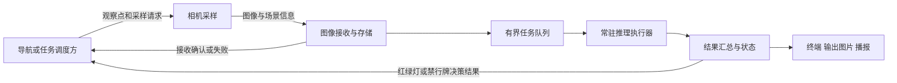

# 异步识别与资源调度：需求分析和方案草案

状态：设计讨论，尚未实现或在实车验证。本文描述识别侧如何与导航协作；导航路线与运动控制由相应负责人实现。九个任务的初步等待策略以 [`config/perception_tasks.json`](../config/perception_tasks.json) 的 `scheduling` 为准，并生成至任务 README 与总览；这些文字当前仅用于文档，尚不是可执行的调度参数。

算法选型、平移视频的应用边界及总体分级架构统一见 [项目方向](PROJECT_DIRECTION.md)。本文仅维护交接、状态和资源机制；下文的单帧交接适用于定点观察，扫描任务采用独立的分段交接。

## 希望达到的效果

小车到达合适观察位置后，采集可用于多个任务的图像，确认数据已由识别侧接收并保留，然后继续执行允许继续的路线。识别、目标框绘制、保存结果、终端输出和播报在后台进行。模型应常驻或按资源计划复用，不能每到一个任务点就重新启动一个完整模型进程。

需要减少的是**等待识别结果的停车时间和重复推理**。画面质量不作为现场考核或离开观察点的条件。单帧可覆盖的任务优先采集一帧并继续；车牌与电动车按有界视频扫描主流程开发，实验验证采集、关联和融合参数；现场不等待画质判断。红绿灯需要持续观察。一个画面中的多个目标可由一次检测统一产生结果；如果不同任务需要不同模型，仍可能需要对同一张图片进行多次模型推理。

比赛每轮 5 分钟，时间限制会影响后台队列：路线跑完不等于所有结果已经输出。需要将采样、排队、识别、图片保存、播报和最终汇总的耗时一并计算，并给未完成任务明确状态。

### 全局原始数据复用与模型调度

原始图像或视频的采集、保存与引用由全系统统筹：同一观察满足多个任务的视野、时间和分辨率要求时，可将同一份原始数据分发给各自任务；覆盖不足则按任务补充采样。共享采集不等于共用模型或一次推理，也不要求不同模型同时运行。各任务保留观察身份、独立结果及失败状态。例如 A/B 街的人物与直立或倒伏电动车可能出现在同一画面，但不能预设一帧一定覆盖全部目标。

全局比较各模型串行、有限并行或混合调度，尚未确定最终方案。以完整比赛回合为单位，在目标设备测量采集与交接、模型加载、排队、推理、关联汇总、存图和播报耗时，以及 CPU/GPU、内存和存储带宽峰值；记录并发竞争、队列积压及截止时间内完成率。将红绿灯和禁行牌等实时安全决策的响应时限放入同一资源预算，并确保它们不被后台作业阻塞。根据实测选择并发上限、队列容量、优先级和超时处理，而不是预先假设并行更快或所有任务都可以等待到路线结束。

模型按路线和任务需求异步提前加载与预热，后期任务不要求在启动阶段全部加载。协调器依据任务首次需要推理的时刻、实测加载与预热耗时及资源余量提前安排；路线分支确认后更新计划。模型就绪以加载和必要预热完成为准，加载失败或超时明确报告。门控模型未就绪时保持安全等待并按有限重试策略处理；可后台处理的任务在原始数据交接成功后可继续导航，作业等待模型，但必须受队列容量和任务截止时间约束。启动至关键功能可用的等待、各任务模型就绪时间及额外等待单独记录，整轮加载预算仍包含延迟加载和重载。

## 分工与数据流

建议先用**一个识别协调节点，加少量常驻工作进程或执行器**实现，内部以队列或事件分发；是否拆成多个 ROS 节点在实车测量后决定。ROS topic 适合发布状态、结果或通知，但单独发出一条消息不等于数据已被接收和保存；观察点交接需要请求、确认、超时和失败反馈。大图通过 ROS 图像消息、同机文件路径还是其他进程通信方式，需根据带宽、拷贝次数、延迟和接口复杂度实测选择，先不要引入外部消息中间件。

## 哪些任务可以继续行驶

各任务的当前候选策略在统一配置中维护。这里解释分界和共性：

- **等待决策**：禁行牌必须在需要选择分支之前获得可靠结果；红绿灯应在等待线前持续观察，并只将新鲜、稳定的绿灯结果交给通行决策。未知、过期、断流或执行器不可用时保持等待，不能用旧结果放行。信号灯状态应独立于可能积压的离线图片队列。
- **后台处理候选**：人物、火灾、垃圾桶、热异常、仪表、车牌和电动车的计算通常可在采集之后进行。离开前只需确认采集请求与必要原始数据交接成功，不等待画质判定、模型识别和人工检查。具体交接耗时及路线配合方式与导航方实测。
- **需要时限的后台任务**：A/B 街人数、电动车分类等依赖多个观察点汇总。即使允许离开，也必须在比赛有效时间内完成统计、图片和播报；等待超时应输出未完成或部分完成，不能把缺失数据作为零。

## 一次观察如何交接

1. 调度方发出包含本次运行 ID、观察点 ID、任务类型、场景身份和期望传感器的采样请求。采集前先确认队列和图像存储资源可接收；不能接收时返回明确失败，不能声称已接收。
2. 采样侧取得符合请求时序的一帧，记录采集时间、相机 ID、画面尺寸及来源；多帧或多传感器任务还要保存各帧身份、时间和对应关系。只检查是否实际取得数据及必要的身份信息，不在交接路径上评定清晰度、遮挡或目标覆盖。
3. 对计划后台处理的观察，接收方将必要原始图像和元数据写入该次运行的指定位置，确认写入成功且任务已登记后，回复 `accepted`；此时调度方才能按既定路线继续。不能写入、队列已满、未取得帧或等待超时，回复失败；是否重试由有上限的现场策略决定，不能无限等待。不能先回复成功再依赖尚未保存的内存帧。
4. 后台执行器根据观察点身份和任务类型消费数据，产生带来源图像引用、识别状态、结果和耗时的输出；绘图使用对应的原始帧。对同一场景需要多个模型时，共用一次采样和同一份原始图像。
5. 汇总侧关联相关结果、保存规则要求的标注图、输出并播报；同一观察的重复请求或重复结果通过运行 ID、观察 ID、任务 ID 和尝试号识别，不重复累加人数或重复播报。

上述交接是建议的协议语义，不预设某个 ROS 消息或话题已经存在。原始图像能保存多久、是否全分辨率、图像格式、保存位置和比赛结束后如何处理，须根据规则、存储容量及评估目的约定；至少在本轮相关识别与证据产出完成前保留所需原始数据。存储空间不足、图片损坏或写入失败要明确报错，无法保证“任何情况下永不丢失”。

写入确认会占用一定交接时间，这是尽早放行与保证原始数据已保存之间需要实测的代价。可以先预热存储、复用缓冲并压缩交接路径；如果改为仅内存接收后立即放行，必须明确该方案在进程或电源故障时可能丢失数据，不能把内存接收说成已保存。极短耗时且不影响主进程的画质提示可以作为可选后台功能；不等待它、不以它决定离开，也不因此自动补拍。是否值得启用以实测为准。

## 事件、时序与任务状态

### 视频扫描交接

扫描开始前为预计时长、码率及必要输出预留磁盘和写入能力，准备有限的编码缓冲。`scan_started` 只表示采集通道准备完成，可配合导航进入扫描路线，不表示全程数据已保存。短片段写完、关闭且登记成功后发布 `segment_ready`，后台只读取已就绪片段；消息携带路径、扫描 ID、片段序号、帧时间范围及场景/位姿引用，不携带全部解码帧。

扫描结束发布 `scan_closed`，确认全部预期片段就绪及覆盖信息齐全后才标记 `capture_complete`。片段丢失、写入失败、采集断流或提前结束须记录缺口，最终状态为部分完成或失败。采集/编码队列达到上限时通知协调器按既定上限暂停扫描或终止本次采集，不能继续行驶并谎报完整覆盖；具体停车位置由导航方保证。正常持续写盘不要求每片结束停车。

推理按时间顺序流式解码，图像在每个有限批次结束后释放；推理跳帧与原始视频记录分开，保留采样时间差。跟踪跨片段延续同一扫描上下文，不能在切片边界清空 ID。换场景或运行时显式重置，不复用旧身份。在线预览结果可以先产生，完整计数和证据状态仍需等扫描覆盖检查与融合完成。

### 分级状态与事件归属

建议比赛层为 `ready → running → draining → finished`；`draining` 停止接纳非必要新作业并在截止前完成已有输出。观察层区分定点采样与扫描子状态；作业层独立推进排队、执行、融合及输出，每层都有失败/取消分支。状态机分层不等于每层必须部署一个 ROS 节点。

各状态只由其所有者修改，协调器汇总状态，不允许多个节点竞争改写同一作业。事件至少带运行、观察/扫描、作业、尝试号和事件身份；旧尝试和重复事件不能重复计数、释放资源或播报。取消必须收到执行器确认或确认进程退出后才能认定其资源已释放，超时标记本身不会停止计算。实时门控使用独立新鲜结果，不从离线扫描输出推断通行。

建议使用 `capture_requested`、`capture_accepted`、`capture_rejected`、`job_started`、`job_completed`、`job_failed`、`result_reported` 等事件名称作为讨论词汇，最终接口待联调。一个任务可以经历“待采样 → 已接收 → 排队中 → 推理中 → 已得到结果 → 图片/播报完成”，另设超时、失败及部分完成状态。不要把入队成功误认为识别成功，也不要把识别完成误认为输出图片和播报完成。

每个结果至少关联运行、观察、任务与场景 ID、采集时间、处理时间、状态和图像引用；模型版本、配置版本与识别细节按任务记录。采集时间用于对应场景；处理耗时、超时和比赛倒计时建议使用单调时钟，避免系统时间调整影响计时。ROS 时间和传感器时间的关系须在设备上核实，不能直接假设多个时钟同步。

存在前置关系的任务采用显式等待：例如 A/B 两街结果到齐后汇总；停车区正常/倒伏需完整覆盖后汇总；图像保存和绘制完成后再标记证据就绪。多个后台结果可能乱序到达，汇总按身份而不是按到达顺序归属。长时间没有结果时按任务截止时间产生未完成记录，迟到结果保留状态并由规则确定能否输出计分。

## 资源和拥塞

### 模型加载计时和资源对照

完整方案加载目标约 10～20 秒、上限 60 秒，定义与验收边界以[项目方向](PROJECT_DIRECTION.md#模型加载时间指标项目目标待实测)为准。该指标覆盖实际使用的全部模型、必要预热与运行时切换/重载；赛前或后台延迟加载也要登记，不能把任务必需模型排除。记录进程启动、框架初始化、各模型加载起止、首帧准备和预热完成、卸载与再加载、任务可用及首次真实推理结果的单调时间戳。多个并发区间统计墙钟并集，同时记录每模型总时长，分别记录冷/热缓存。失败、超时和未加载的必需模型进入结果，绝不算作零耗时成功。

对照同一任务组合与硬件，比较：共享检测器与任务后处理、少量模型有限常驻、按需加载及必要时卸载。分别量启动等待、加载墙钟并集、各模型合计、首帧延迟、赛中切换与排队、峰值内存以及门控和后台截止前完成情况；不能仅按加载秒数选方案。OCR 两路和规则必需模块均纳入，不因合并模型牺牲细粒度准确率或端到端证据。方案、指标尚待小车实测，协调器与计时记录也尚未实现。

- 为实时红绿灯/禁行牌决策与后台任务分别设置容量或预留资源；限制后台并发、队列长度、内存和磁盘占用，具体数值在小车上测量后配置。
- 先测导航、相机、模型和写盘同时运行的 CPU、内存、帧率与延迟，再决定每个模型常驻、轮流加载还是共享检测器。受 CPU/GPU、模型框架和 Python GIL 等影响，多个线程或进程不一定更快。
- 优先选择高时效或高影响任务，再考虑任务截止时间与预计执行时间；但避免后台任务长期饥饿。优先级本身不会中断正在运行的推理，必要时通过限制后台运行时长、单独执行器或预留计算资源保障实时任务，具体是否可抢占需依赖框架实测。
- 有界队列满时，未接收新任务应明确拒绝并通知调度方；对已确认接收的原始数据不能静默丢弃。可视比赛时间和剩余资源选择补拍、暂停等待或标记未完成，不能无限等待。
- 模型加载失败、相机断流、数据不可读、工作进程退出、存储写入失败及播报失败都必须产生可见状态；恢复与重试次数、时间上限按任务配置。规则要求的结果和证据缺失时不得标记该任务完全成功。

## 借鉴操作系统的方法

### 资源回收如何接入

采用统一资源账本和本地释放的分工：协调器登记谁持有何种资源、配额和生命周期；执行器管理自身内存及模型，存储管理器唯一负责删除允许清理的动态文件。

| 资源 | 持有与释放责任 | 生命周期规则 |
| --- | --- | --- |
| 相机帧、解码帧、张量 | 采集/推理执行器 | 有界缓冲与有限批次，用完释放引用；不得积累全部视频帧或带原图的推理结果列表 |
| 模型实例及设备内存 | 模型执行器 | 记录活动作业数；无活动作业且策略允许时卸载，加载前做准入，切换阶段预热。测量实际驻留量，不把释放 Python 引用等同于立刻归还系统内存 |
| 原始图像、视频片段 | 存储管理器 | 写入中、已就绪、消费者使用中、输出完成、按策略保留；本轮必要数据保留至相关任务与证据完成，后续按明确保留配置清理 |
| 裁剪、临时绘图、解码产物 | 所属作业与存储管理器 | 优先按需生成，消费者全部结束后成为可清理项；不能仅按文件年龄删除仍在使用的文件 |
| 标注图、统计结果、播报状态 | 输出组件与存储管理器 | 记录来源与完成状态，按本轮成果保留策略管理；播报失败不导致原始数据被误判为无需保留 |
| 跟踪与融合上下文 | 扫描执行器 | 只保留必要轨迹摘要、有限候选帧引用与关联记录；扫描收尾后输出并释放，跨扫描不直接复用 ID |

资源登记建议包含运行 ID、资源 ID、所有者、消费者集合、写入状态、大小、保留类别及释放状态；释放操作要幂等。执行器退出时先确认退出、撤销其作业尝试并核对尚存消费者，才能释放该尝试占用的登记项。心跳丢失或租约到期只能触发核查，不能单凭超时删除其他进程仍在读取的文件。

内存压力处理顺序：停止接纳额外后台作业，减少解码批次与并发，清理已完成中间件和空闲模型，再报告资源不足；不能依靠无限交换空间维持运行。必要时在作业边界重启已排空的执行器回收框架驻留，但不能中断仍在写入或仍持有结果的任务。磁盘压力先清理明确可清理的临时产物，再拒绝无法保证容量的新扫描；不能删除已确认接收且尚需处理的原始数据。

`reset` 是状态转换：停止接纳、取消或排空作业、等待所有者确认、关闭写入、保留规定成果、释放临时资源，再以新运行 ID 初始化。晚到结果只能归档到原运行或拒绝参与当前统计。比赛截止与资源紧张均可令任务部分完成，但不能把缺失输出当成功。

需测量并配置的预算包括：导航和系统基础内存、模型权重与激活峰值、编码/解码缓冲、并发工作集、输出空间及余量。磁盘视频预算按码率乘时长并加入容器与证据余量；压缩文件大小不能用于估算解码内存。持续写速、编码 CPU、单作业内存峰值、模型切换延迟和队列最老等待时间都进入联调指标。尚未取得硬件数据，不在文档里指定通用 MB、帧率或并发数。

以下是应用层的设计方法，不假定 Ubuntu、Python 或模型框架会自动提供硬实时保障。

| 操作系统概念 | 在本项目中的对应方案 | 需要解决的问题 |
| --- | --- | --- |
| 前台与后台任务 | 导航与实时信号决策走低延迟路径；静态场景识别、绘图和播报走后台 | 慢模型不能让关键路径无限排队 |
| 进程和线程 | 协调器、采集、推理、存储和播报按职责隔离；具体放同一进程还是多个进程由测试决定 | 进程隔离可控制故障范围，但模型会占用额外内存、数据可能发生拷贝 |
| 任务控制块与状态机 | 每项工作记录 ID、场景、状态、优先级、截止时间、数据引用及错误 | 乱序和重复结果仍能归属，状态转换可追踪 |
| 调度和优先级 | 实时决策单独通道或预留能力；后台按截止时间和价值排序，并限制饥饿 | 高优先级不保证能中断已经开始的模型推理；要测最长阻塞时间 |
| 进程间通信与同步 | 使用明确的请求、接收确认、结果事件和汇总条件；同图像可供多个子任务引用 | topic 消息、文件或内存通道的延迟与失效语义不同，需要实验后选型 |
| 内存与 I/O 管理 | 队列、图像缓冲和磁盘写入有容量与所有权；图像保存完成前不释放必要数据 | 内存入队很快但故障可能丢失；写盘确认会增加交接延迟 |
| 资源竞争与死锁 | 规定相机、模型执行器、图像缓冲和写盘的所有权、排队上限与超时；不持有一个资源无限等待另一个 | 避免模型、相机或存储相互等待；具体锁与执行模型尚待实现 |
| 异常和监控 | 记录采样、排队、推理、输出的延迟及失败，定期报告队列积压与执行器状态 | 故障或超时不能被当成零、成功或允许通行 |

候选的第一版可以把采集交接、关键决策和后台推理分为独立队列，后台模型按有限并发运行；绘图、写结果和播报继续异步处理。是否采用进程、线程、ROS 节点或操作系统级资源限制，要以实车的导航稳定性、模型框架和测得的延迟为依据，不提前锁定实现。

## 比较与头脑风暴

| 方案 | 优点 | 代价与待验证点 |
| --- | --- | --- |
| 单节点、单后台队列 | 调试简单、数据传递少 | 重任务可能拖慢实时识别；需隔离关键任务 |
| 一个协调节点、少量常驻执行器 | 可以限制并发并区分实时与后台任务 | 进程内存、进程通信和模型加载时间需实测；建议作为第一版候选 |
| 每类识别独立 ROS 节点 | 各任务可单独调试与重启 | 模型和图像重复加载、通信及内存负担可能变大 |
| 统一目标检测器加任务后处理 | 同一帧可一次检测多类目标 | 多类别训练和小目标准确率待评估；无法天然替代 OCR、热成像和仪表读取 |
| 连续视频缓存后统一取帧 | 减少停车，适合运动中覆盖大场景 | 帧选择、运动模糊、重复计数和存储压力更难；先与停稳拍摄基线比较 |

可以让单次观察生成多个关联子任务，例如 A 街画面同时服务人偶和违停电动车；将每个子任务完成、失败及图片引用分别记录。D 楼保留红外数据及采集时间，并根据热图中的楼层区域判断结果。摄像头采样前后的车辆停稳要求也需与导航方共同测定。

## 先验证什么

1. 离线比较每种任务在单张照片、短时间多帧和不同观察点下的识别准确率及采集耗时，确定是否提前配置多帧；现场不把画质判断作为离开条件。
2. 实测相机取帧、写入原始图、模型冷/热加载、单次推理、绘图、终端输出、播报和汇总耗时；记录 CPU、内存和存储占用。
3. 在真实导航和识别同时运行时，测试后台堆积、红绿灯及时性、断流、写入失败、队列满、乱序、重复事件和临近 5 分钟的未完成任务。
4. 根据数据决定节点数量、并发度、任务优先级、采样方式及时限，再实现接口和独立验收；本文件不代表这些机制已经运行。

## 从一键启动到本轮结束（2026-11-06，目标流程）

本节为统一流程的维护入口；逐任务算法见[方法设计](research/OPEN_SOURCE_METHODS.md)、[仪表设计](research/METER_VISION.md)与[双 OCR 设计](research/PLATE_DUAL_OCR.md)。下述流程尚未由现有配置读取器实现。

1. **赛前配置**：按现场地图标定两条允许路线、观察段、物料朝向、停车目标及相机外参；每条路线分别核对全部任务覆盖。观察段记录可服务任务、场景身份、采样模式和完成条件。相邻任务只有确实同框且分辨率足够时才共享采样。
2. **启动准入**：一键创建新的运行 ID，冻结本轮配置，检查必要传感器、模型文件、地图定位、输出目录及资源余量。调试按任务开关运行；完整比赛方案必须核对必需任务未被意外关闭。禁行牌和灯控不能被调试开关绕过后继续自主通行。
3. **路线门控**：沿已经确定允许行驶的路段到达相应观察区，在分支前完成禁行牌及摆位判断。根据现场映射选择路线；未知则等待或有限重试。每遇信号灯进入独立实时观察，导航在等待线前停车，依据新鲜有效状态决策。门控触发位置以路线为准。
4. **观察执行**：导航控制平移与转向，识别侧按观察请求采样。定点采样在原始文件写入和作业登记成功后确认交接；扫描先确认写入能力再开始运动采集，分段登记，到扫描结束才核对完整覆盖。实时灯控始终与后台队列隔离。
5. **作业派生**：一个街区帧可派生人物和违停任务；楼宇、垃圾桶和温湿度表按对应场景派生分支。各分支共享原图，按各自模型和算法推理。任务按运行/观察/实例身份关联，避免乱序结果混入另一场景。
6. **有限并发处理**：协调器按门控需要、截止时间与资源余量调度；执行器流式读取磁盘数据并运行共享核心，释放批次内存。模型加载也计入预算，不能启动全部任务模型常驻。队列满或写入失败产生明确拒绝/失败状态，不能先确认成功再丢数据。
7. **归属和汇总**：先完成实例识别，再做跨帧关联、区域覆盖和统计。A/B 人物依赖两街结果，电动车依赖三个区域，车牌各车位独立，火灾各楼独立，垃圾桶各桶独立，仪表各读数独立。有效分项可以先输出；父任务缺必要分项则为部分完成。
8. **证据与播报**：将框和针线绘制回对应原图，输出终端文字并进入有界语音队列；一个播报执行者串行播放以免互相覆盖。门控结果可先供导航使用，语音与图像另记状态。每条播报具有任务/结果身份，避免重复播放；队列预计播放时间纳入剩余比赛预算。
9. **收尾与泊车**：沿路线执行最终泊车，车头朝向街道；识别后台可以同时完成已有任务。预留收尾预算，停止接收无法在有效时限内完成的非必要工作，汇总未完成项。导航到终点不代表识别成功，识别完成也不代表已经正确泊车。截止后新产出的结果标为迟到，不计入及时完成成果。
10. **结束与重置**：记录本轮各任务、图片、终端及语音状态，关闭采集并确认执行器结束，按资源生命周期释放临时内容、保留规定成果。新一轮使用新 ID，拒绝旧消息参与统计。

路线不应在本文写成一串固定任务顺序：PDF 的两条红线路径和物料朝向是约束，实际观察顺序由对应路线计划决定。路线覆盖表逐项列出两处灯、指示牌决策、A/B 街、A/B/C 楼、D 楼、站房仪表、四桶、三车位和非机动车停车区。站房图像覆盖温湿度表刻度、指针及下方电表显示窗。赛前核对各必要观察点及取景。

全流程联调需覆盖单任务启用、两种路线、后台积压、重复与迟到事件、传感器断流、部分识别失败及临近截止的收尾。不以 Windows 离线通过代替 ROS/实车验证；所有阈值、资源上限与时间预算都应有测量来源。
