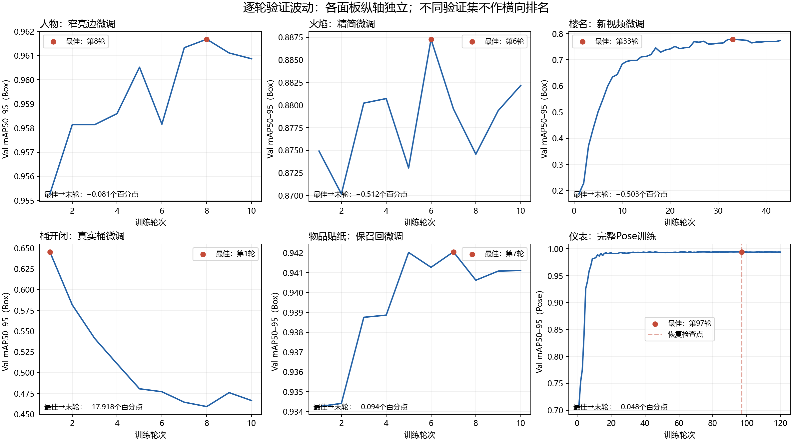

# V4 数据集与模型训练阶段报告

观察日期：2026-11-19。范围：八项 V4 视觉任务的数据制作、已回传训练及本地微调。车牌沿用省赛方案，不计入这八项数据任务。本次更新文档与源码，没有新启动训练，也没有创建正式数据版本或模型发布标签。

本报告依据实际导出目录、标签、分集清单及运行回执整理。[可核查摘要](DATASET_MODEL_REPORT_20261119.json)保留统计值、模型 SHA-256、原始回执路径和文件 SHA-256；原图、逐图标签、权重与完整运行包不随 GitHub 仓库分发。摘要记录观察时的研发仓库 HEAD，工作树内尚未提交的实现也属于此次同步范围。后续进展继续维护于[当前生产进度](../DATASET_PRODUCTION.md#当前生产进度)，本报告保留本次观察结果。

## 数据集现状

表中按当前目录实际枚举图片和标签，框数按非空标签行计数；仪表每个实例另有八个关键点。这里只复核数量与清单，未重新解码全部图片或复跑历史几何审计。不同任务可复用底图及固定物料，不能把各行相加解释为独立采集场景数。

| 任务 | Train / Val / Test 图片 | 三集合实例总数 | 三集合空标签图 | 当前监督与范围 |
| --- | --- | ---: | ---: | --- |
| 人物 | 3000 / 300 / 300 | 10,933 | 319 | 社区／非社区立牌框；实拍、实拍底图与 Blender 底图合成 |
| 仪表 | 6480 / 1080 / 1080 | 7,776 | 864 | 八点 Pose；62,208 个标签关键点，54 张原生完整实拍，其余以合成为主 |
| 火焰贴纸 | 3000 / 300 / 300 | 5,704 | 720 | 指定贴纸框；四类生成方式，含红桶、灯体等硬负和同框干扰 |
| 楼名纸条 | 3000 / 300 / 300 | 4,152 | 756 | 单类 paper 定位；不包含楼名 OCR 或跨帧唯一计数验收 |
| 禁行牌 | 2500 / 300 / 300 | 2,500 | 650 | 完整、截断、杆底座及普通杆干扰；Test 无普通信号杆专项覆盖 |
| 垃圾贴纸 | 1800 / 240 / 240 | 5,130 | 228 | 24 类物品贴纸框；每图零至四贴 |
| 垃圾桶开闭（当前微调输入） | 804 / 186 / 253 | 2,373 | 141 | 开／闭两类整桶框；颜色用于诊断，补拍 session 全部归 Train |
| 电动车（冻结首轮基线） | 108 / 10 / 未建立 | 402 | 4 | 直立／倒伏框；当前另有182张小样，研究集与基线导出分开 |

垃圾桶开闭完整基线使用 **3500 / 186 / 253**，共3939张；当前804张 Train 是后续真实桶主导的微调输入，不能倒写为远程基线的数据规模。垃圾贴纸和火焰的专项微调也各有独立数据入口，不抵扣全量计划。配置及来源从各任务 `datasets/scripts/<task>/config/source.yaml`、[学习目标](../../config/task_targets.yaml)及[组合轴](../../config/combination_axes.yaml)追溯。

来源隔离以各批实际记录为准：背景父视频分集或图片去重不能证明固定前景、母场景和历史初始化均未接触。仪表白盘／彩盘共享几何，人物共享立牌，贴纸共享固定图案，桶任务共享部分 Blender 资产；电动车开发集含镜像、邻帧和已知场景。以上评估主要支持当前来源的受控诊断。

另据[来源迁出记录](../../datasets/README.md#来源资产已迁出2026-11-19)，选定真实来源、数字原图和Blender主工程已经迁往相邻的 `AIAEC-VisualRecognition`。旧配置及数据库中的路径保留历史声明，旧工程不能作为这些已迁来源的现行生产入口；本报告的数据量来自仍保留的导出与运行结果，不证明旧制作命令现在可以直接重建。

## 已完成完整训练与回传评估

下表均为既有运行结果，mAP取值0–1。最优轮由 Val 选择；Val/Test 列取完整评估的实际值，因此与训练日志选模分数可能有小幅差异。TP/FP/FN 是固定阈值诊断计数，不能用框架曲线选择的 Precision/Recall 直接替代。六项在这些报告中的诊断阈值为 conf=0.25、NMS IoU=0.7、匹配 IoU=0.5；仪表专项另对预测点使用0.5置信度。

| 模型 | 完成轮数 / 最优轮 | Val Box mAP50–95 | Test Box mAP50–95 | Test TP / FP / FN |
| --- | --- | ---: | ---: | --- |
| 仪表 | 120 / 97（Pose选模） | 0.99460 | 0.99499 | 971 / 25 / 1 |
| 火焰贴纸 | 135 / 37 | 0.88414 | 0.85569 | 475 / 9 / 5 |
| 楼名纸条 | 135 / 108 | 0.89870 | 0.90007 | 332 / 28 / 2 |
| 禁行牌 | 115 / 95 | 0.90707 | 0.99500 | 225 / 0 / 0 |
| 垃圾桶开闭 | 120 / 112 | 0.65581 | 0.90131 | 388 / 2 / 27 |
| 垃圾贴纸 | 150 / 94 | 0.96365 | 0.97067 | 539 / 16 / 1 |

人物完成150轮基线及10轮窄亮边微调，留用后者的最佳推理权重。此次核查到的53张开发回归里，微调前后 TP=83、FN=6，FP从29降到4；该集合有已知来源及训练复用，不能当独立Test。电动车首轮20轮基线 Val mAP50=0.740、mAP50–95=0.425，同图两态计数全对仅1/10，随后另做了有界研究。

回传运行记录的环境示例为 Windows 11、Python 3.12、Torch 2.7.1+cu128、Ultralytics 8.3.203；不同机器的 Python补丁版本不同。仪表经历 CUDA illegal memory access，随后从第97轮检查点恢复并训练至120轮，后续冻结与Test状态为完成；不能只读取旧 `train_status.json` 的失败值判断最终进度。上述环境与耗时不证明 Ubuntu 20.04／ROS Noetic／Python 3 的部署兼容。

## 任务效果与微调结论

**仪表。** Val/Test Pose mAP50–95分别为0.99431／0.99320。Test972个真值中漏1个，108张无表图有2张产生误检。温度针投影角平均误差1.91°，湿度针10.52°；两项各971个可测实例，另1个漏框仍计入分母。高Pose AP并不保证湿度读数合格。当前独立推理按轴心、针尖和量程端点估算等角度刻度，尚无透视校正或实物逐刻度标定；完整温湿度物理误差仍待验证。[推理入口与限制](../../lab/features/meter/inference/README.md)

**火焰贴纸。** 精简Train1224张、固定10轮、batch4，约572秒，Val选择第6轮。统一640输入及0.25阈值下，Test红桶误检8→3、总FP9→4、TP475/480→480/480；Val TP474/480→480/480但FP0→2。2400张未参加本次微调的旧Train两版均3760/3760检出且零误检，这是旧训练回归。用户随后根据已接触诊断选择0.5作为推理建议：缓存预测过滤后红桶误检归零，但Test漏2个小贴纸，Val/Test仍各留1个其他误检；该阈值不是未接触Test上的预先冻结方案。

**楼名纸条。** 新视频专项实际43轮，Val最优第33轮，约344秒，没有混入原始3000张Train。相同CPU、640输入、conf0.25下，新同场景Val21张整图全对10→18；旧Test300张TP333→334、FN1→0，但整图全对268→264。事后0.8置信度回放旧Test整图全对279→296，新Val8→16；属于已接触集合上的阈值诊断。检测纸条、识别文字和跨帧计数是三个不同验收对象，当前证据只覆盖检测。

**垃圾桶开闭。** 最新真实桶主导方案固定10轮、640、batch4，从原始远程best重新初始化；Val选第1轮。Val整桶漏检265→257，额外预测2→3；Test整桶漏检27→28、状态判错0→2、额外预测2→43，整图全对225/253→193/253。指定红桶在640下仍漏，不能宣布解决。第10轮last在Test漏49桶、错2桶、额外预测49，不能以最后完成的权重代替最优候选。补拍目前缺成对低机位开盖和高俯视，后续补充应针对这些实际失败。[训练与数据入口](../TRAINING_WORKFLOW.md#垃圾桶开闭训练包)

**垃圾贴纸。** 最新保召回微调完成10轮，Val选第7轮，候选未采用。360张已知挑战Test在相同图签下FP162→31、FN5→7；条纹空负仍11/20张误报。基础240张Test与360张挑战Test分母不同，不能混在一张成绩表里。冻结骨干162个张量完全相同仍出现漏检和类别回归，不能由参数冻结推断召回不变。原始远程best继续作为参照，真实白色部件误报与小贴纸漏检仍待解决。

**人物与电动车。** 人物保留10轮窄亮边方案；后续30轮虽压制亮边，但另有召回／误检取舍，不能覆盖既定选择。电动车研究中原26张开发图数量全对17→20，严格逐车框／姿态全对16→18；10张实拍实际来自5个原帧及其镜像，严格正确4→5/10。计数存在错漏抵消；研究候选尚未替换正式部署，固定开发集上的提高不能推出全路线计数可靠。[电动车研究记录](E_BIKE_COUNTING.md)

## 识别置信度改进前后对照

以下重新统计已有逐框预测，没有重新推理或训练。[置信度与逐轮波动证据](DATASET_MODEL_REPORT_20261119_CONFIDENCE.json)包含分母、P10/P90、同一真值配对差值及原文件摘要。**阈值**是保留预测的设置，**输出置信度**是模型给每个框的分数，**mAP／召回率**衡量预测与真值的关系，三者分别报告。置信度尚未做概率校准，0.95不能解释为95%的实场正确率。

所有行均在conf≥0.25、匹配IoU≥0.5下统计，保持同一行的原图和真值不变；火焰、桶、人物及楼名输入640，物品贴纸960，NMS IoU均为0.7。TP采用现有共享评估器的类别一致一对一匹配；表中的中位数只针对实际检出的框，漏检保持无分数。桶开闭专项使用另一种不区分类别的整桶匹配来诊断状态，所以不能把这里的TP数直接当作上一节的正确开闭数。

| 对照与样本范围 | 正确框置信度中位数：之前→之后（差值） | 误检框置信度中位数：之前→之后 | 正确框数：之前→之后 | 误检框数：之前→之后 |
| --- | --- | --- | --- | --- |
| 人物，53张已知开发图 | 0.9131→0.9204（+0.0073） | 0.6582→0.3024 | 83→83 | 29→4（−25，−86.2%） |
| 火焰，300张Test | 0.9475→0.9389（−0.0087） | 0.8210→0.3498 | 475→480 | 9→4（−5，−55.6%） |
| 楼名，新同场景Val21张 | 0.4179→0.8570（+0.4391） | 0.4296→无误检 | 4→10 | 2→0（−2） |
| 楼名，旧Test300张 | 0.9364→0.8836（−0.0528） | 0.7907→0.5819 | 333→334 | 50→38（−12，−24.0%） |
| 桶开闭，253张Test | 0.9834→0.9706（−0.0128） | 0.3950→0.4282 | 388→387 | 2→43（+41） |
| 物品贴纸，360张挑战Test | 0.9542→0.9638（+0.0096） | 0.5061→0.4879 | 575→573 | 162→31（−131，−80.9%） |

为了避免“只剩容易检出的目标，所以分数提高”的偏差，再只比较两版都检出的**同一真值**：人物83个目标的逐目标置信度差值中位数+0.0051（75升／8降）；火焰475个−0.0052（119升／356降），另找回5个、没有丢失旧检出；新楼名Val共同4个+0.4643，另找回6个；旧楼名Test共同333个−0.0537，另找回1个；桶Test共同384个−0.0101，新增丢失4个、找回3个；物品贴纸共同573个+0.0103，但新增丢失2个且没有找回目标。整组中位数之差与逐目标差值的中位数不同，不能混写。

人物窄亮边的连续22帧另有针对性记录：产生被跟踪误框的帧数22→1；在检出帧内，该误框置信度中位数0.6631→0.2872。改善主要是压制白侧板误报，而非把所有对象置信度都抬高。该22帧相关且包含4张训练复用帧，不是22个独立场景。

**这些变化对识别的实际影响：** 火焰Test召回475/480→480/480，提升1.04个百分点，虽然正确框分数中位数略降；新楼名Val召回4/13→10/13，提升46.15个百分点，旧Test整图全对却268/300→264/300，下降1.33个百分点；物品贴纸挑战Test召回575/580→573/580，下降0.34个百分点，虽然正确框分数上升。桶整图正确225/253→193/253，下降12.65个百分点。置信度提高、误报减少与任务成功率提高必须分别判断。

仪表和禁行牌本轮只有完整训练结果，没有相同输入下的微调前后配对预测，故不编造置信度提升值。电动车已有计数与逐车匹配对照，但本报告未重新统计其候选验证器的置信度；其评分机制与单个YOLO检测分数也不能直接混比。

## 微调波动、末轮回落与副作用

下面从各运行 `training/results.csv` 逐轮提取Val mAP50–95。**百分点**指指标差×100；例如0.64550降至0.46632是下降17.918个百分点，不是下降0.17918个百分点。各行Val集合与监督不同，仅用于本运行的变化判断。仪表行为完整训练，其余五行为微调。

| 运行 | 首轮→最佳→末轮 mAP50–95 | 最佳轮 / 总轮数 | 最佳到末轮回落（百分点） | 相邻两轮最大下降（百分点） |
| --- | --- | --- | ---: | ---: |
| 人物窄亮边微调 | 0.95527→0.96168→0.96087 | 8 / 10 | 0.081 | 0.236 |
| 火焰精简微调 | 0.87492→0.88728→0.88216 | 6 / 10 | 0.512 | 0.770 |
| 楼名新视频微调 | 0.18671→0.77883→0.77380 | 33 / 43 | 0.503 | 1.658 |
| 真实桶主导微调 | 0.64550→0.64550→0.46632 | 1 / 10 | **17.918** | **6.397** |
| 贴纸保召回微调 | 0.93425→0.94205→0.94111 | 7 / 10 | 0.094 | 0.143 |
| 仪表完整训练（Pose） | 0.70676→0.99434→0.99386 | 97 / 120 | 0.048 | 0.387 |

图中每个面板使用各自纵轴范围，红点为Val最佳轮；仪表红虚线标出恢复检查点所在轮次。逐轮原始值和损失保存在置信度与波动摘要中。这里的“波动”是按epoch的验证指标变化，没有重新运行多个随机种子，也没有据此推断跨视频帧的闪烁率或统计显著性。

桶模型首轮即最好，后续最低降到0.45906、末轮只回到0.46632；与Test新增误报及指定红桶仍漏的现象一致，说明继续同配方训练没有带来稳定改善，但这些观测不足以将原因唯一归为过拟合、学习率或数据域偏移。最后一轮Test整桶漏检49、额外预测49，比原模型的27／2明显差。保留best／last及原模型分别诊断，不能因为跑满10轮就采用last。

贴纸运行的Val曲线变化很小，仍在挑战Test丢失2个原先检出的目标；因此曲线平稳不等于任务无回归。火焰Val最佳后回落0.512个百分点，同时Val新增2个误检；楼名在新域大幅学会定位后，旧Test正确框置信度普遍下移、整图结果出现取舍。这些副作用均与收益一并保留，不将单一最高指标写成全面提升。

## 本次核查与接续入口

研发工作区与公开源码副本分别通过109项相关回归测试；覆盖Pose读数、桶及贴纸专项报告、当前计划登记与训练包构建等。研发工作区109份活动Markdown的1406个本地链接检查为零问题。公开副本不含本机数据及运行证据，对应本地材料链接不可用；公开生成统计按实际分发文件重算，缺少的标注证据保持未知，完整历史观察保留在本报告摘要。

全局目录检查仍发现 `datasets/raw/waste_bin_state/reshoot` 不符合现行 `targets/camera/<batch>/...` 布局：任务来源配置已引用该批，目录检查器不接受这个旧落点。此次没有移动补拍原件或修改既有运行输入，因此不将全局布局检查写成通过；该问题不影响此次文档、源码及聚合报告的GitHub同步。

数据已能支持多任务完整基线；远程完整训练及回传结果已落地，后续改进必须同时检查误检、漏检、状态和整图成功率。当前优先缺口是湿度读数、真实桶定位与开闭、白色干扰和小贴纸召回、电动车逐车匹配与计数。楼名尚须单独验证OCR和跨帧行为，禁行牌仍需覆盖实景普通杆与门控失败。

此次GitHub同步提供当前文档、任务定义、制作／训练／评估脚本与上述聚合报告。源码不是完整可运行数据包；公开克隆需要另行准备有权使用的数据、初始权重及环境。没有上传原始数据、权重、便携环境或运行目录，没有替换实车模型，也没有完成Ubuntu／ROS／实车验收。[训练流程](../TRAINING_WORKFLOW.md)及[离线交付](../OFFLINE_DEPLOY.md)为后续入口。
